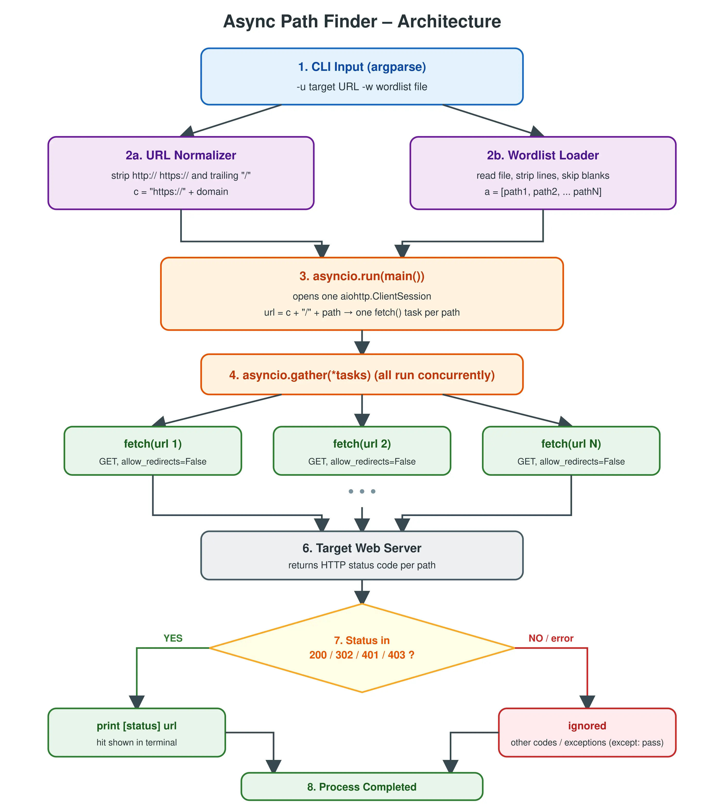

# Softknock (Educational Purposes)

<p align="center">
  
</p>

<h1 align="center">Softknock</h1>

<p align="center"><strong>A quiet walker of paths.</strong></p>

<p align="center"><em>Knock on a thousand doors at once. Say nothing. Listen for the ones that answer.</em></p>

<p align="center">
  
  
  
</p>

---

## The idea

Every web server keeps a shape underneath the surface — `/admin`, `/backup`, `/.git`, `/uploads`, `/phpinfo.php`. None of them are linked from the front page. They are just *there*, waiting behind names that someone forgot to guess.

`Softknock` takes a wordlist and a target and walks the whole list in parallel, one coroutine per door. It does not follow redirects, because a redirect is still an answer. It prints only what matters: the doors that opened, the doors that stood locked and said so, the doors that told you to go away. Everything else — the soft 404s, the timeouts, the empty rooms — passes by in silence.

Small. Fast. Single file. No framework, no database, no config.

---

## Preview

<p align="center">
  
</p>

```console
$ python softknock.py -u example.com -w wordlists/common.txt
  [+] [200] https://example.com/admin
  [+] [403] https://example.com/.git/config
  [+] [301] https://example.com/uploads
  [+] [401] https://example.com/api
  [+] [200] https://example.com/robots.txt
  [+] [+] [+] [+]  Process Completed  [+] [+] [+] [+]
```

Green means someone answered. That is all green has ever meant here.

---

## Install

```bash
git clone https://github.com/you/softknock.git
cd softknock
pip install aiohttp
```

That is the whole ceremony. One dependency, and it is already in your virtualenv if you have ever touched an async project.

---

## Usage

```bash
python softknock.py -u <target> -w <wordlist>
```

| Flag | Long form | What it does |
| :--- | :--- | :--- |
| `-u` | `--url` | The target. Bare host or full URL — the scheme is normalized to `https://` either way, and trailing slashes are trimmed so paths never double up. |
| `-w` | `--wordlist` | A text file, one path per line. Blank lines are skipped. Leading slashes on entries are handled, so `/admin` and `admin` behave identically. |

### Example

```bash
python softknock.py -u bseindia.com -w paths.txt
```

Here's what each piece of that command means:

- **`softknock.py`** — the script itself.
- **`-u bseindia.com`** — the **target**. This is the host Softknock will probe. You can give it bare (`bseindia.com`) or with a scheme (`https://bseindia.com`); either way the tool normalizes it to `https://bseindia.com` with no trailing slash, so every path built from it is consistent.
- **`-w paths.txt`** — the **wordlist**. This is a plain text file sitting next to the script, with one candidate path per line, e.g.:

  ```text
  admin
  /backup
  uploads/
  .git/config
  ```

  Softknock reads this file line by line, strips blank lines, and strips any leading `/` from each entry before rebuilding it — so `admin`, `/admin`, and `admin/` all resolve to the same request.

Put together, that command tells Softknock: *take every line in `paths.txt`, append it to `https://bseindia.com`, and ask each one at once.*

**Same thing, written lazily:**

```bash
python softknock.py -u https://bseindia.com -w paths.txt
```

**Redirecting the output somewhere quiet:**

```bash
python softknock.py -u bseindia.com -w paths.txt | tee hits.txt
```

---

## What it reports

| Status | Meaning | Why it's shown |
| :--- | :--- | :--- |
| `200` | Exists and serves content | The path is real. |
| `301` / `302` | Exists, but moved | A redirect is a fingerprint. Servers rarely redirect to nowhere. |
| `401` | Exists, locked | Authentication stands in front of something. |
| `403` | Exists, refused | The file is there; the permissions are not yours. |

Everything else — `404`, `500`, connection resets, DNS hiccups — is swallowed. Errors are caught broadly and deliberately, because a wordlist run should survive a few bad doors without dying on the first one.

---

## How it works, part by part

```python
import argparse
import asyncio
import aiohttp
```
Three imports, nothing else. `argparse` reads the command line, `asyncio` runs everything concurrently, `aiohttp` makes the actual HTTP requests without blocking.

```python
parser = argparse.ArgumentParser()
parser.add_argument("-u", "--url", required=True)
parser.add_argument("-w", "--wordlist", required=True)
args = parser.parse_args()
```
Defines the two required flags described above and parses whatever was typed on the command line into `args.url` and `args.wordlist`.

```python
c = "https://" + args.url.replace("https://", "").replace("http://", "").rstrip("/")
```
Builds the normalized base URL: strips any scheme the user already typed, trims a trailing slash, then re-adds `https://`. This is why `bseindia.com` and `https://bseindia.com/` both end up as `https://bseindia.com`.

```python
with open(args.wordlist) as f:
    a = [line.strip() for line in f if line.strip()]
```
Reads the wordlist file into a plain Python list, one entry per line, dropping blank lines.

```python
async def fetch(session, url):
    try:
        async with session.get(url, allow_redirects=False) as response:
            if response.status in (200, 302, 401, 403):
                print(f'  \033[1;32m[+]\033[0m [{response.status}] {url}')
    except:
        pass
```
One coroutine per URL. `allow_redirects=False` is what lets a `302` actually be reported — without it, aiohttp would silently follow the redirect and the original response would never be seen. Only the four status codes above get printed; anything else, and any exception (timeout, DNS failure, connection reset), is swallowed by the bare `except: pass`.

```python
async def main():
    async with aiohttp.ClientSession() as session:
        tasks = []
        for i in a:
            url = f"{c}/{i.lstrip('/')}"
            tasks.append(fetch(session, url))
        await asyncio.gather(*tasks)
```
Opens one shared session (so sockets get reused), builds the full target URL for every wordlist entry, and schedules every one of them as a task. `asyncio.gather` then runs all of them concurrently — the whole wordlist is in flight at once, not one request after another.

```python
asyncio.run(main())
print("\033[1;32m[+]\033[0m"*4 + "  Process Completed  " + "\033[1;32m[+]\033[0m"*4)
```
Kicks off the event loop and, once every task has finished, prints the completion banner.

---

## Known edges

Worth knowing before you point this at something large.

- **No concurrency ceiling.** `gather` launches the entire list simultaneously. Against a wordlist of 100,000 entries you will open 100,000 sockets and some servers will start dropping connections instead of answering them. Batching with `asyncio.Semaphore`, or chunking the list, is the fix.
- **`https://` is forced.** Plain-HTTP-only hosts will fail silently on every request. There is no fallback probe.
- **Bare `except`.** A `KeyboardInterrupt` mid-run is caught and discarded like any other error, so the completion banner prints even when you killed it. It also means genuine bugs hide well.
- **No wildcard filtering.** If the target returns `200` for every path, every path will be printed and the output tells you nothing. Run once against a random string first and check.
- **No recursion, no extensions, no depth.** One list, one level, exactly as written.

---

## Ethos

```
Small tools, sharp edges, no telemetry.
```

No progress bars. No pretty tables. No JSON export nobody reads. If you want more, the file is eighty lines and every one of them is legible.

---

## Disclaimer

Point it only at hosts you have permission to touch. Most targets will not mind. A few will notice.

---

## License

MIT. Take it, rename it, keep the green.

<p align="center"><sub>Built for the quiet hours, when the internet is mostly dark and mostly asleep.</sub></p>